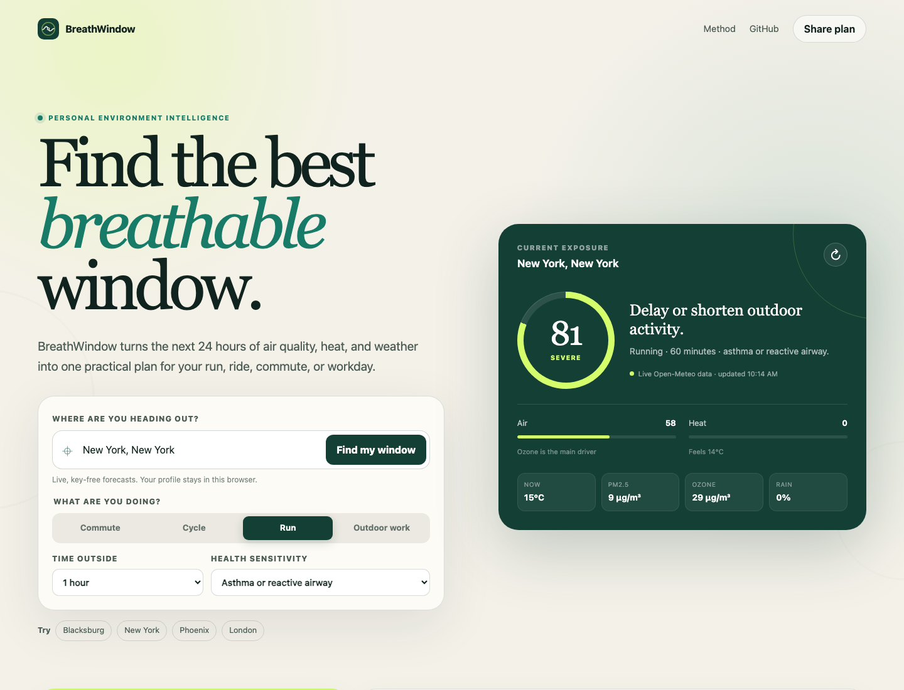

# BreathWindow

**Know the healthiest window for your next run, ride, commute, or outdoor workday.**

[Open the live app](https://bgrubbs1.github.io/breathwindow/) · [Watch the 2:36 demo](https://www.youtube.com/watch?v=AnBMZNgU8Ds)

BreathWindow is a privacy-first, open-source web app that turns live hourly weather and air-quality forecasts into a personal outdoor exposure plan. Instead of showing a generic AQI number, it estimates how pollutant dose, ozone, heat, rain, activity intensity, duration, and health sensitivity combine for the next 24 hours.

## Preview



## Why it matters

Air quality changes hour by hour, but most public indices summarize an entire day. A person with asthma, a parent planning recess, or an outdoor worker needs a time-specific answer: *When is my next 30 minutes outside likely to be safest?*

BreathWindow answers that question with a ranked set of windows and concrete low-exposure actions. It works without an account and keeps profile selections in the browser.

## Features

- Live hourly forecasts from key-free Open-Meteo APIs.
- Personalized exposure score using activity breathing rate, duration, PM2.5, ozone, apparent heat, rain, wind, and sensitivity.
- Three ranked windows in the next 24 hours.
- Interactive hourly risk chart with per-hour pollutant and heat context.
- Actionable playbook for timing, route, heat, and rain.
- Copyable and shareable plans; print-friendly layout.
- Clearly labeled sample fallback so the interface remains usable if a live API is unavailable.
- Installable PWA with an offline app shell.
- Responsive, keyboard-accessible interface with reduced-motion and print styles.

## Run locally

```bash
cd breathwindow
npm test
npm run serve
```

Open `http://localhost:4173`.

There is no build step and no runtime dependency. The app is plain HTML, CSS, and ES modules.

## Deployment

The repository is designed for GitHub Pages. Publish the repository root from the `main` branch. All asset paths are relative, so the app works at both a user site and a project subpath.

## How the score works

For each hourly forecast, BreathWindow:

1. Scales pollutant exposure by minutes outside and the ventilation rate of the selected activity.
2. Scores fine-particle dose and ozone separately against planning thresholds.
3. Adds apparent-heat and weather stress.
4. Applies a health-sensitivity multiplier.
5. Ranks the next 24 hours and highlights three non-overlapping lower-exposure windows.

The model is intentionally inspectable in [`src/model.js`](src/model.js) and covered by deterministic Node tests. It is a planning aid, not a medical device or a regulatory AQI forecast. Users should follow local public-health alerts and clinical advice.

## Data sources

- [Open-Meteo Weather Forecast API](https://open-meteo.com/en/docs)
- [Open-Meteo Air Quality API](https://open-meteo.com/en/docs/air-quality-api)
- [Open-Meteo Geocoding API](https://open-meteo.com/en/docs/geocoding-api)

No API key is required. The app does not send user health selections to a server; requests contain only the selected coordinates and forecast parameters.

## Project structure

```text
.
├── index.html
├── styles.css
├── src/
│   ├── api.js
│   ├── app.js
│   └── model.js
├── tests/model.test.js
├── docs/
│   ├── breathwindow-demo.mp4
│   └── screenshots/
├── manifest.json
└── sw.js
```

## License

MIT
